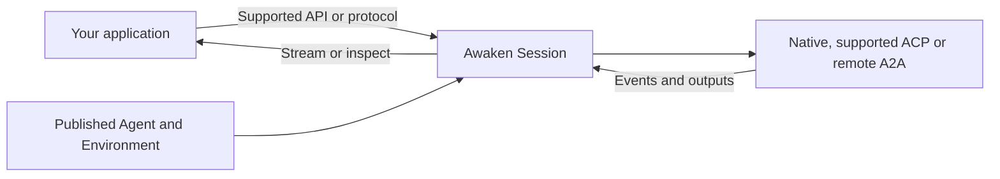

# Awaken Agents

Build and run AI agent applications on your own infrastructure.

Awaken Agents is an open-source, self-hostable execution platform for AI agent
applications. Start its local Console, publish an Agent, and connect your
frontend or backend through supported APIs. Awaken provides Agent publication,
persistent Sessions, resource bindings and tool permissions. Your application
keeps its interface, business rules and result checks.

[Quickstart](#build-from-source) · [Connect your application](#build-with-awaken) ·
[Rust SDK](crates/sdk/runtime/awaken-runtime/README.md) · [Documentation](docs/README.md)

## Why Awaken

- **Start locally with the Console.** Create, review, publish and run an Agent
  with the API and local Worker in one service. The built executable contains
  the Console and needs no Node.js at runtime. [Try it](#try-awaken).
- **Keep work across connections.** Reopen the same Session and inspect its
  committed history after reconnecting or restarting. Eligible interrupted work
  follows the configured [recovery policy](docs/design/remote-worker-protocol.md#recovery).
- **Control tool actions.** Configure supported tools to allow, deny or wait for
  a human decision before execution. Approval resumes the existing work through the
  [permission path](docs/design/permission-policy-axis.md#permission-flow).
- **Use your existing application stack.** Connect backends and frontends through
  the supported Managed Agents, AI SDK and AG-UI interfaces; use A2A for Agent
  communication and MCP for exported tools. [Choose an interface](#build-with-awaken).
- **Choose how the Agent runs.** Use Native execution, a supported ACP runtime
  or a remote A2A Agent. Execution capabilities depend on the selected adapter
  and Environment; see the [runtime capability guide](docs/design/acp-harness-capability-and-tool-bridge.md#decision).
- **Reuse task context and procedures.** Attach files and repositories, configure
  persistent MemoryStores and bind versioned Skills. Inspect the resources used
  by a Session through the existing [resource model](docs/design/resources-memory-files-skills.md).

## What you can build

- **Assistants and copilots:** connect a product UI or backend to a published
  Agent and reopen the same Session across connections.
- **Repository assistants:** inspect a mounted repository, propose a focused
  change and run checks with the configured filesystem and tool permissions.
- **Research applications:** use supplied files or configured search tools,
  produce a sourced brief and inspect its inputs and output.

The Console includes Task assistant, Repository change and Evidence brief
[starters](web/src/lib/agent-starters.ts). A starter supplies an editable draft;
its tools, resources and model still need to be available in your Environment.

## Choose your starting point

| You want to | Start here |
|---|---|
| Run an Agent service and connect your application | [Try Awaken](#try-awaken), then [build with Awaken](#build-with-awaken) |
| Embed the execution core in a Rust application | [Runtime SDK](crates/sdk/runtime/awaken-runtime/README.md) and its [independent consumer](examples/sdk-consumer/README.md) |
| Self-host and operate the service | [Operate Awaken](#operate-awaken) |
| Contribute to Awaken | [CONTRIBUTING.md](CONTRIBUTING.md) and the [engineering docs](docs/README.md) |

An Agent defines published behavior; an Environment describes execution
requirements. A Session holds ongoing work and committed history, and a Run
executes work within that Session.



## Availability

This guide describes the development source in its own checkout. Use the source
path below for this version. Public [Releases](https://github.com/awakenworks/awaken/releases)
can belong to an older release line; use documentation matching the package you
install.

## Build from source

Use a checkout of the revision you intend to evaluate. You need Rust 1.96.0
(from [rust-toolchain.toml](rust-toolchain.toml)), Node.js 22 (used by
[CI](.github/workflows/quality.yml)), and pnpm 11.6.0 (from [package.json](package.json)). Cargo's
existing Console build step installs the locked Node dependencies and embeds the
built Console in the executable:

```console
cargo build --locked --release -p awaken-cli --bin awaken -p awaken-sandbox --bin awaken-sandbox --features awaken-sandbox/hand
./target/release/awaken --version
./target/release/awaken-sandbox hand --check
./target/release/awaken doctor
```

Keep `awaken` and its matching `awaken-sandbox` execution companion together.
These are the same binary targets and Hand feature used by the release builder.
The built program needs no Node.js or external web directory at runtime. On
Linux, Namespace execution needs usable bubblewrap (`bwrap`); read the doctor's
result before choosing an execution tier. The deployment guide owns the
[platform and isolation choices](deploy/README.md#local-execution-tiers).

## Try Awaken

### 1. Start the local service

From the same checkout:

```console
./target/release/awaken --no-browser
```

Open the local URL printed at startup, normally <http://127.0.0.1:8080>. Follow
the one-time setup link or token if startup prints one. AllInOne starts the API,
embedded Console and local Worker together, and keeps local state under
`~/.awaken`. Use `--port` for an occupied port or `--data-dir` for a dedicated
evaluation directory. Once installed on your PATH, `awaken` starts the same mode.

### 2. Create and publish an Agent

In the Console:

1. Connect a model provider, or sign in to a detected, supported ACP runtime.
2. Open **Quickstart**. Choose **Task assistant** or describe your Agent.
3. Review the draft, model and Environment before publishing it.
4. Use a small first task, for example: “Reply with a two-item checklist for
   reviewing an API change.” Review, publish and start the Session.

A description or starter produces an editable draft. Review and publish the
Agent to make that revision available for execution in the selected Environment.

### 3. Inspect one result

Open the Session and confirm that the Agent answered the task and returned to
idle. Inspect the committed messages and any tool or permission activity.
An application still decides whether that answer meets its own quality bar.

| What you see | Next action |
|---|---|
| Provider or model is not ready | Correct the connection or login in the Console; check its recorded error |
| Work stays queued | Check Environment readiness and whether an eligible Worker is available |
| Work waits for approval | Review and answer the existing permission request |
| A permanent admission refusal or terminal error | Inspect the recorded cause and correct the inputs; repeated submission is not recovery |
| An external result is indeterminate | Reconcile that action's actual outcome before retrying it |

Stop with `Ctrl-C`, restart with the same command and data directory, and reopen
the same Session. The earlier committed history should still be there. This
checks persistence. Continuing an in-flight task also depends on its configured
recovery policy and the outcome of any external action.

### 4. Try a task with tools

For a repository task, choose **Repository change**, bind a repository to the
Agent or Session and select an Environment with filesystem tools. Begin with
the starter's inspection task, then request one small change. Set an approval rule before an operation you
want to review: inspect the pending call, allow or deny it, and follow the result
in the same Session. The [tool guide](docs/design/builtin-tools-extension-contract.md)
and [permission guide](docs/design/permission-policy-axis.md) describe the controls.

For research, choose **Evidence brief** and provide Files or a configured
Web/Search tool or MCP server. Check that the brief answers the question and
that its cited sources support it. A successful Run still needs that result check.

## Build with Awaken

After the first task, open the Console's **Integrate** step or **API & protocols**.
Use its contextual example with the published Agent and Environment IDs:

| Your application | Existing interface |
|---|---|
| A trusted backend starting and following Agent work | Managed Agents API and the reviewed official SDK contract |
| A web frontend using AI SDK | Vercel AI SDK message stream |
| An Agent UI using AG-UI or CopilotKit | AG-UI |
| Another Agent exchanging tasks | A2A |
| An MCP client calling explicitly exported tools | MCP |

The Console provides contextual setup and copyable client examples, including
the [Managed SDK example](web/src/lib/sdk-examples.ts). Before migrating an
existing client, check the [SDK compatibility record](packages/managed-sdk-oracle/README.md)
for reviewed versions, supported operations and qualification boundaries.

For the backend path, the maintained example follows four steps: create a
Session using the published Agent and Environment IDs, send a user message,
open the returned Session link, then inspect its reply in the Console. Copy the
contextual example from **Integrate** so it uses your actual IDs and deployment
URL. Use that same Session for subsequent work.

Follow the Console's identity-specific instructions for credentials. Keep a
Workspace service API key in a trusted backend; browser and mobile applications
use scoped, short-lived application access. See [application authentication](docs/application-authentication.md).

Native execution, supported ACP runtimes and outbound A2A are execution choices,
separate from the client protocol. Files, MemoryStores, Skills and tool
permissions remain resource and execution bindings rather than application
business state.

For a Rust process embedding execution directly, start with the [Runtime SDK](crates/sdk/runtime/awaken-runtime/README.md)
and [independent consumer](examples/sdk-consumer/README.md). Internal
[runtime examples](crates/sdk/devtools/awaken-runtime-examples/examples/README.md)
teach composition mechanics; they are an advanced path after the public SDK.

## More capabilities

| You need to | Existing capability and guide |
|---|---|
| Run recurring tasks | [Scheduled Deployments](docs/design/managed-deployments.md): bind an Agent, Environment and initial input to a cron schedule; an admitted occurrence starts a Session |
| Notify another application | [Lifecycle webhooks](docs/design/managed-deployments.md#recovery-and-webhooks): subscribe to lifecycle notifications through the existing delivery and retry path |
| Inspect usage and constrain later model execution | [Session budgets](crates/platform/session/awaken-session-contract/src/budget.rs) use recorded usage and configured price snapshots; they do not cap the total cost of a task |
| Retain useful information across Sessions | The [Memory extension](crates/sdk/extensions/awaken-ext-memory/src/lib.rs) extracts and recalls configured memory; [context compaction](crates/sdk/extensions/awaken-ext-compact/src/lib.rs) manages the current context window separately |
| Add Agent behavior | [Runtime extensions](docs/design/runtime-behavior.md#runtime-extension-surface) provide plugin hooks; [state machines](docs/design/tool-state-machine.md) constrain Native tool sequences, and [delegation](crates/sdk/runtime/awaken-runtime/tests/delegation.rs) exercises sub-Agent execution |

## Fit and boundaries

Use Awaken when your application needs durable Agent work, reusable execution
and explicit tool permissions. A single prompt or a trusted one-off script may
need less infrastructure. Recovery follows committed facts and configured
policy; reconcile uncertain external outcomes before retrying an action.
Capability availability depends on the runtime, provider and Environment you
select. Self-hosting also requires choosing where models, tools and data run.

## Operate Awaken

The [deployment guide](deploy/README.md) owns configuration, execution tiers,
AllInOne and split processes, migration, credentials, backups and operating
boundaries. Local evaluation and a shared production deployment have different
requirements. k3d material is a distributed verification topology.

For deployment or integration support, see [AwakenWorks](https://awakenworks.com/enterprise?product=agents#apply).

## Documentation and contribution

The [documentation index](docs/README.md) routes each reader to its canonical
owner. [CONTRIBUTING.md](CONTRIBUTING.md) explains implementation checks. Product
behavior belongs to code and executable contracts; the documentation model and
synchronization policy are owned by [ADR-0001](docs/adr/0001-documentation-model-and-vocabulary-alignment.md#amendment-2026-11-09-developer-entry-and-downstream-publication).

## License

Apache License, Version 2.0. See [LICENSE](LICENSE). Runtime protocol,
specification and conformance material use Apache-2.0; consult individual
package or file metadata for the code you adopt.
