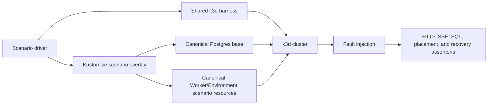

# K3D Distributed Test Topologies

This directory is the deployment-fixture owner for Awaken's real-cluster tests.
The fixtures deliberately separate reusable infrastructure from scenario
behavior so a topology cannot drift through copied Kubernetes resources or
copied cluster setup scripts.

## Static Structure

| Location | Sole responsibility |
|---|---|
| `bases/postgres/` | Ephemeral Postgres Service, readiness contract, test credentials, and storage policy |
| `bases/durable-brain/` | Deterministic Postgres-backed brain Service and Deployment, typed scenario inputs, and unique dispatch ownership |
| `product-backend/` | Private all-in-one product backend with durable control state and retained Session workspaces, no public Service/Ingress, and an ingress allowlist for Awaken Design backends |
| `distributed-control/` | ADR-0071 production Control/Coordinator/Worker composition, four owner databases on a primary/streaming-standby fixture, authenticated boundaries, and a single public edge |
| `failover/`, `scaling/`, `cold-start/`, `nats-wake/`, `worker-failover/` | Placement, replica counts, dependencies, and fault behavior layered over the Postgres and durable-brain bases |
| `e2e/k3d/harness.sh` | Tool admission, cluster lifecycle, Cargo executable resolution, single-platform image import, CoreDNS refresh, collision-free IPv4 port forwarding, and exact-node IPv4 fault injection |
| `e2e/k3d/*_e2e.sh` | Scenario triggers, fault timing, and terminal assertions only |

Kustomize resolves every overlay before Kubernetes creates an object. In
particular, the microservices brain starts with its final durable configuration;
there is no unpatched Ready replica that can receive a request.

## Dynamic Flow



The harness always imports a single-platform application image together with
the cluster's exact Pause and CoreDNS images. Scenario scripts may add
dependencies such as Postgres or NATS, but they must not reimplement import,
cluster creation, executable discovery, port selection, or cleanup.

The product backend uses the Kubernetes sandbox tier and Coordinator's durable
Environment build jobs. The canonical builder first publishes the production
sandbox base locally as `awaken-sandbox:local`; deployment then resolves that
artifact's real OCI digest and uses the same immutable reference for capacity
admission, node import, Session Pods, and the trusted Sandbox control forwarder.
No mutable tag enters the Worker configuration and no Registry pull is needed:

The product overlay selects `container_hand_residency = "resident"`. The
existing Pod channel is the single ACP transport for these Kubernetes Sessions;
it avoids making successful Agent startup depend on whether a particular
apiserver exposes the attached-exec WebSocket protocol. The runtime
ServiceAccount therefore owns namespace-scoped `pods/portforward` for that
resident channel. Attached exec remains a runtime capability for bounded file
operations, not a parallel ACP transport.

### Inspecting retained SQLite data

Do not run host-user `sqlite3 -readonly` directly against the product PVC.
In WAL mode even a read-only connection can create WAL/SHM files or update SHM;
files created by host UID 1000 can prevent the UID 10001 service from reopening
its otherwise writable database. This has been reproduced on the product k3d
storage binding. `fsGroupChangePolicy: OnRootMismatch` is not a repair mechanism
for mismatched child files.

Reuse `SqliteManagedSessionRepository::verify_existing` for structural probes:
its existing `SqliteProbeSnapshot` confines SQLite side effects to a temporary
copy and checks the complete source read set, including uncheckpointed WAL.
For content inspection, use a consistent backup under the service identity and
query the copy. Do not use `immutable=1` on a live database to suppress side
effects: that can ignore WAL state. Never delete WAL/SHM to clear a permission
failure; inspect exact ownership first and preserve retained data.

Historical cleanup diagnosis (2026-09-13): the Classroom Session
`sesn_fnv1a64:5ecd47b4166ccd4f` was created without continuation storage. Its exact
retained Pod UID `c3e57ded-7285-4a25-9e97-362a9373a460` is Failed and has emptyDir
volumes, not a PVC. Recomputing the adoption projection with only the runtime
continuation setting varied gives `fnv1a64:98f6a0f787d8c1d1` for `none` (stored)
and `fnv1a64:cbd5a49e61b966ab` for `storage_class=local-path;size=1Gi` (expected
by the deployed provider). Diagnostic build `a9f14592a` observed exactly this
pair. This proves deployment-policy drift, not permission to delete: the normal
adoption check rejects before terminal provider observation. Cleanup remains
unresolved and must preserve exact-instance, participant and effect fencing;
do not disable the check or rewrite the historical handle. The other retained
Sessions `334d9589d3cb3a8b` and `bea88c8a5c7f995a` separately wait for physical
quiescence; this fingerprint mismatch must not be attributed to them.

The same overlay selects the existing `k8s_continuation_volume` policy. A
retained Session therefore owns one UID-bound `local-path` PVC mounted at its
active filesystem. Pod loss may replace only the Pod incarnation; rebuild must
revalidate the persisted Pod UID and PVC UID before reusing those bytes. The
product ServiceAccount receives only PVC `create`, `get`, and `delete`, matching
the runtime's allocation, exact rebuild, and terminal disposal boundaries.

```bash
deploy/images/sandbox/build.sh awaken-sandbox:local
. e2e/k3d/harness.sh
SANDBOX_IMAGE=$(k3d_image_digest awaken-sandbox:local)
k3d_import_images awaken-product "$SANDBOX_IMAGE"
k3d_render_sandbox_image deploy/k3d/product-backend "$SANDBOX_IMAGE" \
  | kubectl apply -f -
```

Both production-like overlays retain exactly one
`__AWAKEN_SANDBOX_IMAGE__` deployment placeholder. Always render them through
`k3d_render_sandbox_image`; applying either source overlay directly leaves the
required immutable identity unresolved and is rejected by the Runtime.

Package-bearing Environments still require a Registry for the immutable derived
images built by the Kubernetes BuildKit Jobs. Create and attach that Registry
when constructing a package-enabled cluster:

```bash
k3d registry create awaken-registry.localhost --port 5111
# The shared harness accepts the fourth registry coordinate and passes it once
# to `k3d cluster create --registry-use`.
. e2e/k3d/harness.sh
k3d_create_cluster awaken-product 1 2 k3d-awaken-registry.localhost:5000

# Mirror the rootless builder as well as derived Environment images. This keeps
# package materialization independent of Docker Hub availability on every node.
docker tag moby/buildkit:v0.30.0-rootless \
  localhost:5111/system/buildkit:v0.30.0-rootless
docker push localhost:5111/system/buildkit:v0.30.0-rootless
```

`5111` is only the host-published port used by Docker push. Kubernetes Pods and
BuildKit use the Registry container's internal `:5000` endpoint; putting the
host port in `package_image_registry` makes in-cluster pushes fail with
`connection refused`.

The all-in-one Pod never runs or mounts a Docker daemon. It submits bounded,
rootless BuildKit Jobs through namespace-scoped RBAC; those Jobs push immutable
derived Environment images to the same Registry. Session creation waits inside
Awaken for the exact digest, and Session Pods receive that digest instead of
installing packages at startup. Set `k8s_buildkit_image` to the cluster-visible
mirror reference; omitting it retains `moby/buildkit:v0.30.0-rootless` for
backward compatibility.

## Verification Rules

| Rule | Cause | Required effect |
|---|---|---|
| K1 | Valid cluster name, node count, and eviction threshold | One validated cluster create operation with the same policy on every node role |
| K2 | Invalid or option-shaped cluster input | Rejection before any cluster deletion or creation |
| K3 | Duplicate image coordinate | One archive and one import entry for that image |
| K4 | Worker execution topology | Coordinator selects one eligible Worker; that Worker realizes one Session Environment and its sole Hand |
| K5 | Worker or coordinator failure | Durable truth survives; a valid peer reclaims or resumes without duplicate commit |
| K6 | ADR-0071 split-role topology | One public endpoint drives configuration through terminal response; database-less Workers realize exact pins; Pod/node/Provider/Coordinator/Worker/database faults recover from durable truth without duplicate terminal output |

Run the pure harness rules with:

```bash
bash e2e/k3d/harness.sh --self-test
bash e2e/k3d/distributed_control_e2e.sh --self-test
bash e2e/k3d/product_backend_contract_test.sh
```

Run a real topology with its driver, for example:

```bash
bash e2e/k3d/worker_failover_e2e.sh
bash e2e/k3d/distributed_control_e2e.sh
```

Set `ADR71_KEEP_FAILED_CLUSTER=1` only while diagnosing a failure; the default
always deletes its dedicated cluster and disposable role binaries.
The default name is `awaken-adr71`; concurrent worktrees must set distinct
`AWAKEN_K3D_CLUSTER` names and private `KUBECONFIG`/`TMPDIR` locations. Each run
uses `awaken-roles:<cluster>` through the same Kustomize topology, preventing
another worktree from replacing a shared role tag during image import.
Every distributed-control run resolves the current role binaries through Cargo
and builds the Hand through the canonical sandbox builder. Cargo and Docker
retain their incremental caches; the old tag-only reuse bypass has been removed
because tag existence and a working Hand do not establish current-source identity.
The shared harness checks local Docker/tmp filesystem bytes and inodes before
cluster replacement and again before image import, accounting for every node,
transport archives and a reserve. Remote Docker contexts fail closed because
client filesystem observations cannot establish daemon capacity. These are
conservative fixture budgets, not reservations: actual import and cleanup errors
still fail the run. Imported images are intentionally local to these disposable
nodes. The same node storage policy sets the image GC high threshold to 100
on all roles, so a host above the default 85% usage cannot discard an unused
local image between fault stages. Absolute Pod eviction and capacity admission
remain enabled. Image import rejects absent, mismatched or duplicate GC policy
alongside the eviction-policy checks. This is an offline test-fixture policy;
production clusters should serve pinned images from their durable registry.
The [kubelet option contract](https://kubernetes.io/docs/reference/command-line-tools-reference/kubelet/)
defines 100 as disabling usage-triggered image GC.

The scenario driver is the test entry point. Applying a base directly is useful
for inspection, but it does not constitute end-to-end verification.

`distributed_control_e2e.sh` is the canonical black-box acceptance suite for
ADR-0071 and P2-B. The test client knows only `svc/awaken-api`; Kubernetes and
SQL access are used exclusively for fault injection and ownership evidence.
Its eleven stages cover build/deploy, the complete configuration-to-application
path, the complete request-to-response path, Worker process isolation,
Coordinator-total-outage recovery, Pod and in-flight Worker failure, K3D node
network partition and loss, PostgreSQL standby promotion, concurrent pressure,
and a Kubernetes-owned Native Worker crash receipt. Model inference
and its publication fact are the only deterministic edge fixture. The Control
Pod uses the existing scenario adapter to inject that fact into the production
Control assembly; Coordinator and both Workers run the shipped production
artifacts, and no scenario router replaces a business authority.

The final stage first runs the real Kubernetes identity/reopen/stop-evidence
test, then holds only the predecessor's finish ACK after one terminal Provider
response has committed. It hard-kills that exact CRI container, checks its
retained terminal identity, and starts a differently named/UID successor.
Acceptance requires the same public receipt to finish, the old Dispatch row to
settle, the predecessor Pod to be removed, the successor to remain live, and
exactly one Provider request across the crash. This proves the evidence-backed
terminal-recovery case, not safe replay of opaque in-flight model/tool effects
or arbitrary historical Runs lacking termination evidence.

On 2026-09-13 (Asia/Singapore), commit `8864d19ec` passed all eleven stages in
`awaken-adr71-8864-0913` after rebasing the recovery changes onto `9d8dfcb19`.
This includes the non-skipped real Kubernetes identity test, ingress/egress/both
node partitions, abrupt node loss, and Session Awaiting/queued-input recovery.
The pressure stage completed 48/48 requests with zero errors and approximately
3.00 seconds P95; these are fixture observations, not production or DeepSeek
latency guarantees. The script exited successfully and removed its dedicated
cluster and staged binaries. This run selected the harness's existing
`AWAKEN_K3D_BUILD_NETWORK=host` and the Sandbox builder's
`AWAKEN_SANDBOX_BUILD_NETWORK=host`, with the fixture Ubuntu base pinned to the
production management image's digest. The preceding `4f43036f6` attempt failed
before cluster creation on a Docker Hub authentication EOF; it is not counted
as a passing run. Neither capacity admission nor fault assertions were bypassed.
Replicated stateless roles and Workers use a 15-second `not-ready`/`unreachable`
`NoExecute` tolerance in this overlay. A dead node is therefore removed from
Service routing and its workloads become replaceable within the test's bounded
recovery window; the PostgreSQL pair is excluded and follows the separately
fenced WAL-replay-and-promotion path.
The suite also scales the K3S CoreDNS Deployment to two hostname-spread replicas
before application admission. Service discovery therefore remains available
when the node-chaos stage removes either DNS placement; the topology is rejected
up front unless both replicas are Ready on distinct nodes.

The network fault first records the exact container ID, IPv4 address, MAC,
interface and ifindex. The shared harness atomically installs one owned filter
chain on that immutable container ID. Three independent rounds drop ingress,
egress, then both local and forwarded IPv4 traffic on its underlay interface.
Each round validates its exact directional rule inventory before and after the
fault; a cleanup request for a different profile fails without changing rules. It does not detach or reset the interface.
The driver waits for Node unavailability and reads committed Deployment,
Session and unique Event facts through the same public edge. It sends no new
business input while the original executor is unobservable. After exact filter
removal, the original routes, Pod UID and PVC UID must match; every role must
be Ready before one new input is submitted. Any failed rollout propagates its
status, including when the caller uses a Bash OR-list. The following hard-stop
phase sends SIGKILL once to the exact container ID and observes that same object
for at most ten seconds, including when the command ACK is lost. It requires
stopped state and exit code 137 before replacing Pods, and verifies another node
retains the bytes. Observation errors, an incorrect terminal state or an expired
budget reject the fault receipt.

The inline P1–P6, F1–F9 and R0–R5 test comments own the fault-helper and rollout decision
tables. Pure tests reject wrong/replaced identities, partial rules, failed
observations/transactions and silent no-ops; the real topology validates packet
loss, convergence and product outcomes. These containers share one host kernel,
Docker daemon and storage substrate. Passing them does not establish physical
host power-loss durability, independent-host fencing or real switch behavior.

The load stage accepts `ADR71_LOAD_ROUNDS` (default 1, maximum 100). For
repeated acceptance use `ADR71_LOAD_ROUNDS=5`: each round independently sends
the configured request count (default 48, concurrency 12), audits every retained
Session, and requires p95 ≤ 5 seconds. A failing window stops the run; no average
or best-window selection masks it. The separate cold-start bound remains 30
seconds. Record host pressure alongside the run when evaluating shared hosts.

The four logical owner databases share one disposable PostgreSQL primary and
streaming standby to keep this topology affordable. Database names, role
configuration, Worker environment inspection, and socket inspection enforce
the same ownership boundaries required when owners use separate database
servers.

In that fixture, Control receives only `control` and `credentials` plus the
transitional Environment binding in `runtime`; Coordinator receives `runtime`
and the co-located Resources component's `resources`; Workers receive no
database URL or seal key. The two role-specific migration Jobs use the same
configuration and therefore migrate only schemas their target role can acquire.
Those rollout Jobs intentionally run ordinary `database migrate` and never carry
first-install authority. Production orchestration must create the database and
configuration first, then run one disposable Job per role with the same image,
mounts, network policy, and config plus
`--initialize-installation --initialization-reference <CHANGE>`. Only after both
one-time Jobs succeed may it release the unchanged rollout Jobs. The K3D E2E
implements that sequence with `initialize_role_installation`; it does not add a
second manifest or identity source. Later rollouts use ordinary exact-only
migration. Replacing or losing a database therefore makes the rollout Jobs fail
closed instead of silently constructing an empty system under the old Workspace
identity.
Coordinator calls Control's audit, secret-free credential-selection, and
webhook-delivery ports through the dedicated bearer-authenticated boundary;
this token grants no database connection.

`worker_failover_e2e.sh` is retained as a lower-level durable-ingress diagnostic,
not a second P2-B acceptance path: it assigns one run per thread through the
scenario host and isolates lease reclaim/commit fencing. The distributed-control
suite alone owns the public product flow, production CLI Worker, materialization,
service ownership, and full chaos/load claim.
